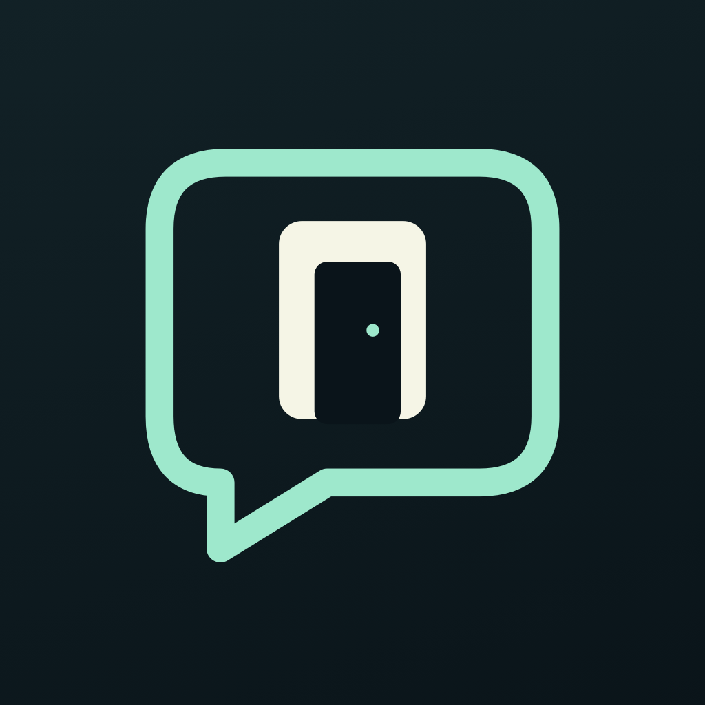
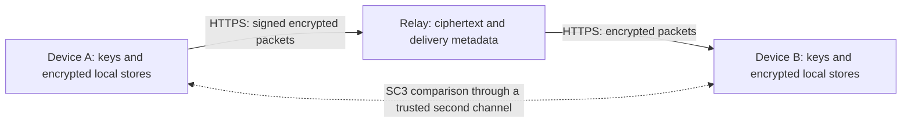

# PrivateRoom

A private space for conversations: an iPhone/iPad messenger with encrypted local storage, deliberate contact verification and a clear account of its limits.

**Status, 13 October 2026:** closed owner beta, under active development. The frozen integration candidate is **1.5.0 (16)**. Its native regression run passed **141 tests with zero failures**, and the signed build was installed and launched on the owner’s iPhone. The owner confirmed that build 15 works; this is useful owner feedback, not exhaustive acceptance of every build-16 flow.

Two native candidate-16 simulators exchanged signed version-3 contact codes; all **17 SC3 groups** matched and were compared and trusted through the actual interface. Intro replay, iPad text-size setting 8, Reduce Motion and basic intro VoiceOver activation were checked. Actual native relay message exchange is still pending. The exact frozen archive **1.5.0 (16)** was uploaded once through the official Xcode distribution path on **13 October 2026 at 15:29:59 CEST**. App Store Connect visibly lists version 1.5.0 / build 16 as **Verarbeitung läuft** (processing). TestFlight tester availability is not yet confirmed; the encryption-compliance dialog remains pending.

The approved-owner-beta relay and redesigned site went live at **12:00:14 UTC**; the live backend remains **0.2.0**, with **26 accepted backend regressions**. Backend **0.2.1**, including operator-only device revocation and **39 passing staged regressions**, awaits final deployment proof. It is not claimed live here. German beta information, URLs, reviewer instructions and the public contact were saved in App Store Connect. No tester invitation, Apple Review submission, App Store approval or independent security audit is claimed.

PrivateRoom is not yet suitable for high-sensitivity communication. **Unreleased 1.5.2 (19)** now uses vodozemac Olm for new messages; distributed 1.5.1 (18) still has no forward secrecy. App-integration review and Apple encryption compliance remain release gates. See [the implementation and limits](Docs/FORWARD-SECRECY-2026-10-18.md) and [prepared release status](Docs/RELEASE-1.5.2-SECURITY.md).

## What the candidate implements

- **Chats and private notes:** conversations with verified contacts, local notes, drafts, search, stars, pins and archive. Local notes have no external recipient.
- **Media:** photos, short videos and files, with encrypted local storage and encrypted chunked relay transfer; the attachment limit is 8 MiB.
- **Deliberate trust:** signed version-3 contact codes and SC3 safety numbers bind both parties' signing and key-agreement keys. Both users compare the number through a trusted second channel before enabling contact messaging.
- **App access:** device-owner authentication, manual lock, inactive-screen privacy cover, background relock and user-session checks around sensitive actions. Failed or stale authentication must not reopen a locked session.
- **Clear delivery state:** queued, sending, accepted by the relay, delivered and failed are distinct. Relay acceptance is not delivery; delivery is not a read receipt. Local notes display **Lokal gespeichert**, not a claim of external delivery; these presentation labels do not alter persisted protocol states.
- **Privacy controls:** optional list-preview masking, reduced keyboard suggestions, encrypted drafts, local retention controls and explicit local deletion confirmations. List masking does not prevent screenshots.
- **Intentional sharing:** transcripts are plaintext exports. The app shows the content and warning before sharing. Its explicit clipboard-copy actions remain local to the device and expire after one minute.
- **A focused interface:** animated introduction with Reduce Motion support, Chats / Kontakte / Privatsphäre, direct contact-to-chat actions and technical configuration outside the ordinary messaging flow.

Verification covers the observed tests and interface actions described above, not every device or operating condition. The selected physical build-15 storage-protection fixture passed once without a skip, and its implementation/test sources are unchanged in build 16; this checks protection metadata, backup exclusion and selective cleanup, not file reads while the phone is locked. Exact boundaries are recorded in the [review](Docs/PRIVATEROOM-REVIEW-2026-10-13.md).

## Data and trust boundaries

The relay is not given message or attachment plaintext by the intended client path. It still processes peer identifiers, packet identifiers, timestamps, recipient routing, ciphertext sizes and acknowledgements. Its network connection can reveal IP addresses and operational metadata. Encryption does not provide complete anonymity or resistance to traffic analysis.

Local message, draft and attachment stores use AES-GCM with device-bound Keychain keys and are excluded from cloud backup. There is no accepted device-transfer or recovery workflow yet: device loss, reinstalling or changing devices can mean permanent data loss. New routine server backups exclude live message queues, acknowledgement tombstones and nonce state; historical encrypted backup and recovery copies still exist. Deleting a local copy does not erase copies retained by recipients or immediately erase those historical copies. Sanitized relay logging also does not eliminate operational metadata retained by the shared reverse proxy's global error logging.

Camera and microphone access follows user-initiated QR, photo or video actions. No advertising or third-party analytics SDK is included in the active client. Diagnostic reports omit chat text, private keys and access tokens, but their technical metadata still deserves review before sharing.

## Active cryptography, without inflated claims

The active protocol-2 path uses Apple's CryptoKit primitives:

| Purpose | Current implementation |
|---|---|
| Device signing identity | Ed25519 |
| Pairwise agreement | Static X25519 identity keys |
| Key derivation | HKDF-SHA256 |
| Message/local-store protection | AES-GCM authenticated encryption |
| Contact verification | SC3 fingerprint of both complete public identities |
| Relay requests | Peer-bound Ed25519 signatures; signed enrollment proves key possession |

The in-tree experimental ratchet work is **disabled**, has not received an independent protocol audit and does not justify Signal-protocol, forward-secrecy or post-compromise-security claims. A well-known primitive does not automatically validate the surrounding protocol, state handling or product.

A future reviewed MLS/OpenMLS integration is being considered. It is not integrated or promised as a shipped feature; its provider, storage, device binding and migration boundaries require their own review. See the [future protocol work](Docs/PRIVATEROOM-REVIEW-2026-10-13.md#future-protocol-work) for the acceptance conditions and primary references.

## Testing the owner beta

1. Build on a trusted Mac with an installed Xcode toolchain and the matching iOS SDK. Open `PrivateChat.xcodeproj`; the existing scheme remains `PrivateChat`.
2. Keep the existing registered bundle identity `org.francois.PrivateChat` for the owner's app. A separate developer fork needs its own signing identity; changing an identifier is not a security migration strategy.
3. Start with local notes. Connecting PrivateRoom is an explicit user action, not an automatic effect of saving a URL.
4. For remote tests, use the approved beta relay contract and two separate approved test identities. Share both contact codes and compare the full SC3 number on both devices through a trusted second channel.
5. Test text, attachment, interruption/retry, relaunch, local deletion and background lock. A local loopback test alone does not establish genuine two-device compatibility.

When the TestFlight build becomes available, relay admission is a **separate explicit beta step**. Each of the two device installations must provide its own **public signed contact code** for approval through the supported contact route. Private keys, passwords and operator secrets are never requested. After admission, compare the full SC3 number on both devices over a trusted second channel. Use only synthetic, non-sensitive test content. Uploading a build or joining TestFlight does not by itself approve a device for relay access.

The canonical public host is [securechat.team](https://securechat.team/). Its hardened contract is live for approved owner-beta devices, which authenticate with their own signing identity. The canonical-host client uses no consumer or operator bearer token. A custom relay remains an advanced, explicitly configured feature. See the [endpoint and authentication contract](Docs/CURRENT-ENDPOINTS.md).

Messages are polled while the app is open and unlocked. There is no shipping promise of background camera activity, guaranteed background delivery, push alerts, calls, group chats or device sync. Muting currently controls local unread-badge behavior.

## Public source and private operations

This repository contains the client, protocol-facing models and tests. Source visibility is not a substitute for an audit; hiding a cryptographic algorithm is not a security boundary.

Keep real private keys, access tokens, operator configuration, deployment credentials, infrastructure addresses, backups, device/peer allowlists, production logs and personal test messages outside this repository. Public design and protocol documentation may explain algorithms, data fields and threat-model limits without exposing those secrets. Do not paste a diagnostic report into a public issue without reviewing its metadata.

The public product name is **PrivateRoom**. Public static project-site source is mirrored in `Website/`; runtime operator configuration and backend state remain private. `SecureChat`, `PrivateChat`, existing source paths, bundle identifiers and protocol header names may remain as technical compatibility names. Existing phase/sprint notes, earlier release listings and old runbooks describe historical work; they do not establish current release or security status. This README, [SECURITY.md](SECURITY.md) and the dated review take precedence for current product claims.

## Help, privacy and security reports

- [Project site](https://securechat.team/)
- [Privacy in German](https://securechat.team/privacy-de.html) · [Privacy in English](https://securechat.team/privacy.html)
- [Support](https://securechat.team/support.html) · [Security model](https://securechat.team/security.html)
- Security reports: follow [SECURITY.md](SECURITY.md); supported contact **miggu69@gmail.com**. Do not disclose vulnerabilities, keys or real messages in public issues.

The repository retains its existing [AGPL-3.0-or-later license](LICENSE). This documentation does not change the license or certify a future distribution arrangement.

## Published website and declaration evidence

The product/support/privacy pages for PrivateRoom and ParaRoam are live on miggu69.info. See [published websites and compatible server patch](Docs/PUBLIC-WEBSITES-2026-10-18.md), the [catalogue source overlay](Website/CatalogueDelta-20261018/README.md), and [actual Apple declaration requirements](Docs/EXPORT-COMPLIANCE-2026-10-18.md). These publications do not authorize distribution of candidate 19.
